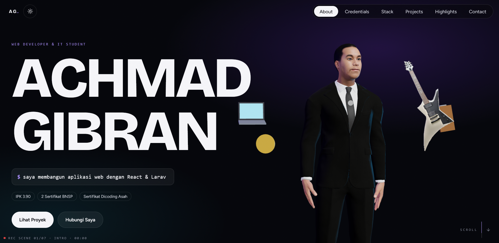
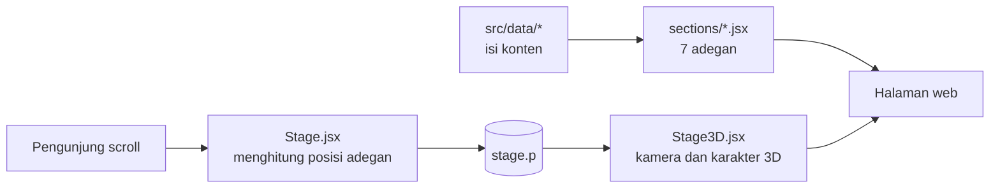
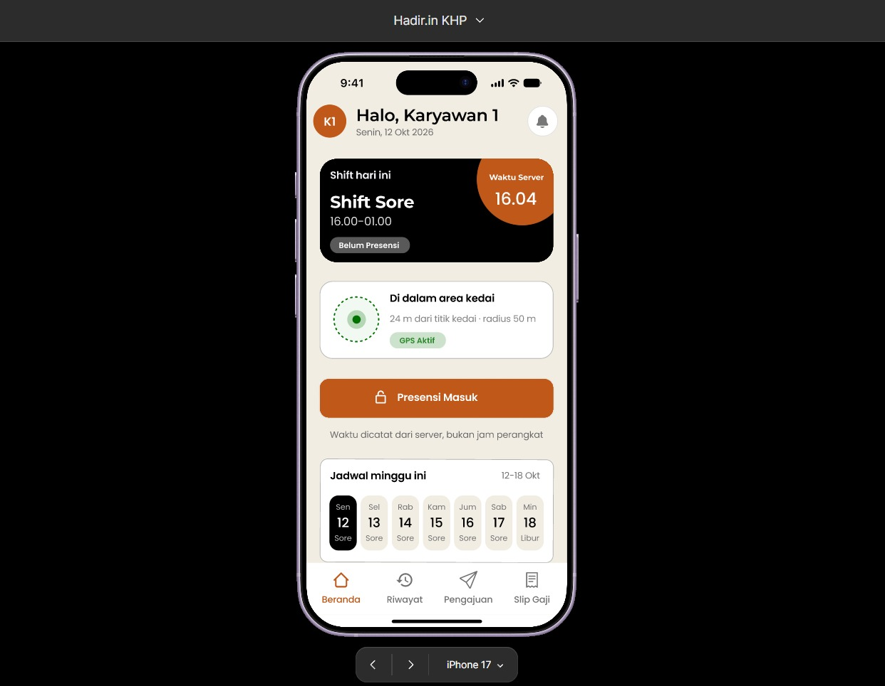
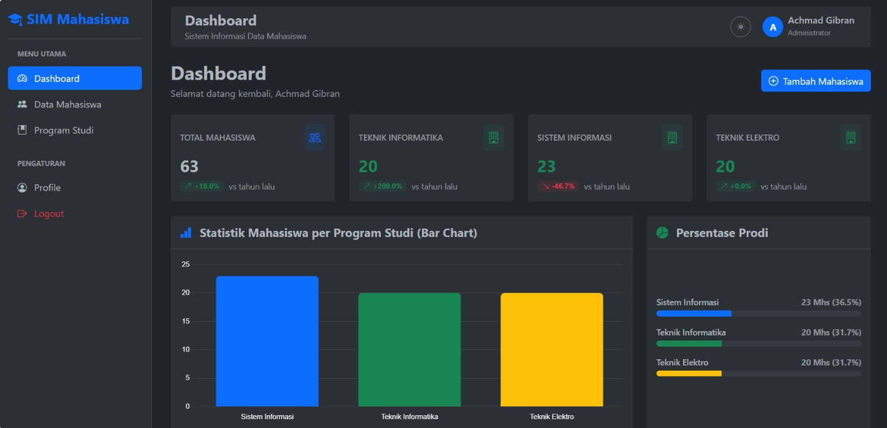
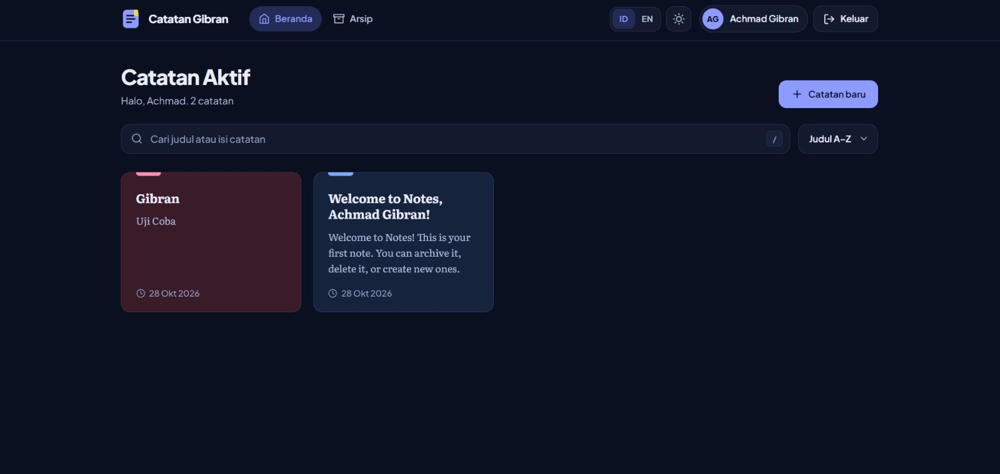
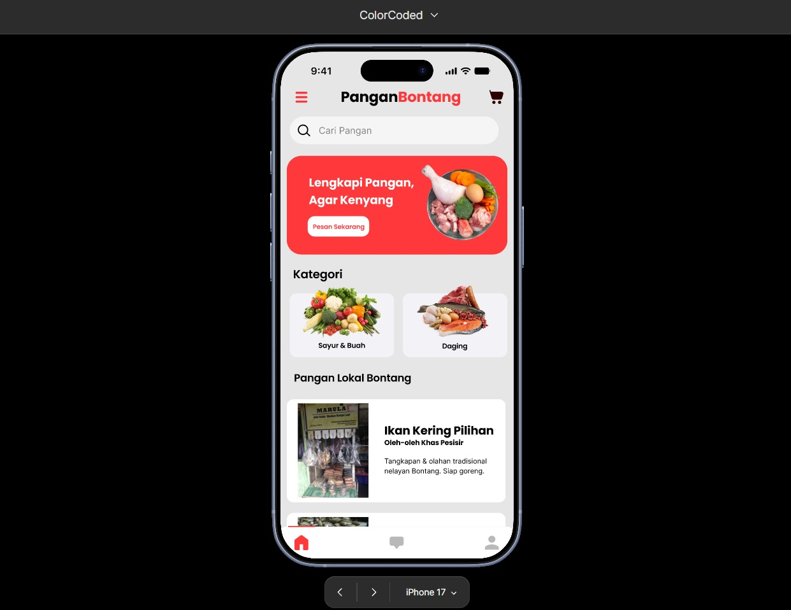
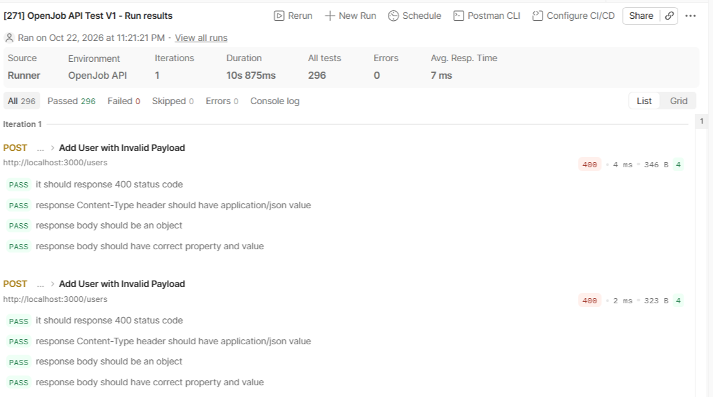

<div align="center">

# Portofolio Achmad Gibran

**Website portofolio sinematik dengan karakter 3D yang berpindah adegan mengikuti scroll.**

[](https://react.dev)
[](https://nextjs.org)
[](https://tailwindcss.com)
[](https://threejs.org)

<br/>



<br/><br/>

[Tentang](#-tentang-proyek) · [Fitur](#-fitur-utama) · [Teknologi](#-teknologi) · [Cara Kerja](#-cara-kerja-singkat) · [Instalasi](#-instalasi) · [Struktur](#-struktur-proyek) · [Kontak](#-kontak)

</div>

---

## 📌 Tentang Proyek

Proyek ini adalah **Personal Website menggunakan React JS**. Website memperkenalkan profil, pendidikan, kemampuan teknis, proyek, serta sertifikat dan prestasi pemilik portofolio.

Konsepnya seperti menonton film: setiap bagian halaman adalah satu **adegan**, dan kamera menyorot karakter 3D dari sudut yang berbeda saat pengunjung menggulir halaman.

| | |
|---|---|
| **Nama** | Achmad Gibran |
| **Program Studi** | S1 Teknik Informatika, STITEK Bontang |
| **Mata Kuliah** | Pemrograman Berbasis Framework |
| **Tugas** | UTS, Personal Website menggunakan React JS |

<!-- Jika sudah di-deploy, tambahkan: 🔗 **Demo:** https://alamat-website-anda -->

## ✨ Fitur Utama

| | Fitur | Penjelasan |
|---|---|---|
| 🎬 | **7 adegan scroll** | Intro, About, Credentials, Stack, Projects, Highlights, dan Contact, dengan HUD ala showreel (REC, nomor adegan, timecode, progress bar). |
| 🧍 | **Karakter 3D** | Model `.glb` dirender dengan Three.js. Kamera, posisi, dan transparansi karakter berubah per adegan. |
| ⏳ | **Loading nyata** | Progres mengikuti unduhan model 3D sungguhan, lalu layar bioskop terbuka. |
| 🌗 | **Tema gelap dan terang** | Tombol "lampu" di navbar dengan animasi lingkaran. Pilihan tersimpan di browser. |
| ⌨️ | **Animasi interaktif** | Teks mengetik di hero, elemen muncul saat di-scroll, dan angka berhitung naik. |
| 🗂️ | **Credentials bertab** | Pendidikan, sertifikat Dicoding, prestasi musik, dan prestasi akademik, lengkap dengan lightbox untuk memperbesar sertifikat. |
| 🧩 | **Daftar proyek** | Proyek coding dan desain dengan teknologi, tipe proyek, tautan GitHub atau prototype Figma, dan bukti pengujian. |
| ✉️ | **Formulir kontak** | Mengirim pesan ke email lewat Web3Forms, dengan cadangan `mailto` dan jebakan bot. |
| 📱 | **Responsif dan ringan** | Tampil baik di desktop dan mobile, render 3D dimatikan saat tidak terlihat, serta menghormati `prefers-reduced-motion`. |

## 🛠️ Teknologi

| Kategori | Teknologi |
|---|---|
| **Library UI** | React 18 (komponen fungsi dan hooks: `useState`, `useEffect`, `useRef`) |
| **Framework** | Next.js 14 (App Router) |
| **Styling** | Tailwind CSS 3 dan CSS variables untuk tema |
| **3D** | Three.js dan `@react-three/fiber` |
| **Ikon** | `lucide-react` |
| **Formulir** | Web3Forms (opsional) |
| **Bahasa** | JavaScript (JSX) |

> 💡 **Catatan:** Next.js adalah framework yang dibangun di atas React. Seluruh antarmuka ditulis sebagai komponen React (file `.jsx`).

## ⚙️ Cara Kerja Singkat



1. `layout.jsx` memasang pembuka (`Loader`), panggung 3D (`Stage`), dan kursor khusus, lalu menampilkan halaman.
2. Setiap bagian halaman (`sections/*`) mengambil isinya dari `src/data/*`, jadi konten bisa diubah tanpa menyentuh komponen.
3. `Stage` mengukur posisi scroll lalu menyimpannya sebagai nomor adegan. `Stage3D` membaca nomor itu dan menggerakkan kamera serta karakter ke posisi adegan tersebut.

## 🖼️ Dokumentasi Tampilan

<details open>
<summary><b>Proyek yang ditampilkan di portofolio</b></summary>
<br/>

| Hadir.in KHP | SIM-Mahasiswa |
|:---:|:---:|
|  |  |

| Personal Note App | PanganBontang |
|:---:|:---:|
|  |  |

| Hasil pengujian OpenJob API (Postman) |
|:---:|
|  |

</details>

## 🚀 Instalasi

**Prasyarat:** [Node.js](https://nodejs.org) versi 18 atau lebih baru dan npm.

```bash
# 1. Clone repositori
git clone https://github.com/AchmadGibran/NAMA-REPO.git
cd NAMA-REPO

# 2. Pasang dependensi
npm install

# 3. Jalankan mode pengembangan
npm run dev
```

Buka **http://localhost:3000** di browser.

<details>
<summary><b>Pengaturan formulir kontak (opsional)</b></summary>
<br/>

Salin `.env.example` menjadi `.env.local`, lalu isi kunci gratis dari [web3forms.com](https://web3forms.com):

```env
NEXT_PUBLIC_WEB3FORMS_KEY=kunci_anda
```

Tanpa kunci ini, formulir tetap berfungsi dengan membuka aplikasi email pengunjung.

</details>

<details>
<summary><b>Build untuk produksi</b></summary>
<br/>

```bash
npm run build
npm start
```

</details>

## 📁 Struktur Proyek

```
├── public/
│   ├── foto/            # foto profil dan screenshot
│   ├── models/          # model karakter 3D (.glb)
│   ├── projects/        # gambar proyek
│   └── sertifikat/      # gambar sertifikat dan prestasi
├── src/
│   ├── app/             # layout, halaman utama, CSS global
│   ├── components/      # Nav, Loader, Stage, ContactForm, CertTabs, dll.
│   │   ├── three/       # Stage3D: karakter 3D dan keyframe kamera
│   │   └── ui/          # komponen kecil: Anim, Lightbox, ImageSlot
│   ├── sections/        # 7 adegan: Hero sampai Contact
│   ├── data/            # isi konten: profile, projects, stack, certificates, dll.
│   └── lib/             # state scroll adegan
├── tailwind.config.js
├── next.config.mjs
└── package.json
```

### ✏️ Mengubah Konten

Semua isi website ada di `src/data/`: `profile.js` (nama dan ringkasan), `projects.js` (proyek), `stack.js` (kemampuan teknis), dan `certificates.js` (sertifikat). Gambar baru cukup disimpan di folder `public/`.

## 📬 Kontak

<div align="center">

[](mailto:achmadgibran27@gmail.com)
[](https://github.com/AchmadGibran)
[](https://www.linkedin.com/in/achmad-gibran-a77545431)

<sub>Dibuat oleh Achmad Gibran, STITEK Bontang</sub>

</div>